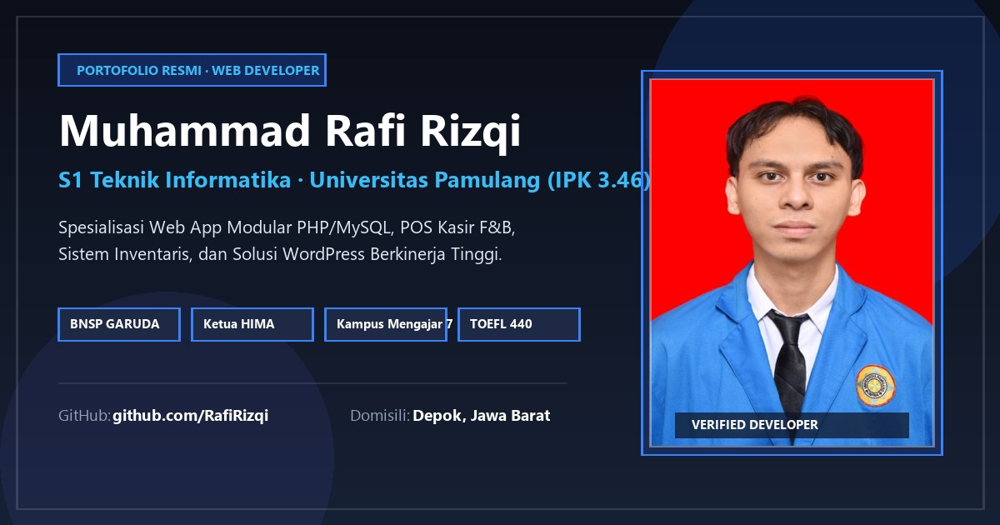

# Muhammad Rafi Rizqi — Fullstack Web Developer Portfolio



[](https://portfolio-rafirizqi.vercel.app)
[](LICENSE)
[](https://portfolio-rafirizqi.vercel.app)

Official single-page developer portfolio of **Muhammad Rafi Rizqi** (Sawangan, Depok), built with pure semantic HTML5, modern CSS, and lightweight Vanilla JavaScript (zero framework bloat).

Live Website: **[portfolio-rafirizqi.vercel.app](https://portfolio-rafirizqi.vercel.app)**

---

## Key Features
- **3D Perspective Project Showcase**: Interactive Coverflow carousel with touch swipe, keyboard controls, and same-page preview modal.
- **Same-Page `<dialog>` Modal (Projects, Certificates & CV PDF)**:
  - High-resolution document preview without leaving the page.
  - Built-in **Page 1 / Page 2 toggle** on the BNSP Programmer certificate (showing all 9 official competency units).
  - Instant **CV Preview + Direct PDF Download** (`CV-Muhammad-Rafi-Rizqi.pdf`).
- **Animated Robot Head Spotlight (`Ctrl+K` / `⌘+K`) & Easter Eggs**:
  - Instant fuzzy search & quick jump across sections, projects, certificates, and CV.
  - **HIIHUU Meme Easter Egg** on first robot click, cursor eye-tracking, tab visibility greeting, DevTools console banner, portrait click achievement, and Spotlight secret commands (`hire`, `matrix`, `hihu`).
- **Performance & Security Optimized**:
  - WebP portrait + lightweight WebP card thumbnails (`<60 KB` each) with HD modal loading on demand and `<link rel="preload">` LCP optimization.
  - Immutable asset caching (`max-age=31536000, immutable`), security headers (`X-Content-Type-Options`, `X-Frame-Options`, `Referrer-Policy`, `Permissions-Policy`), and a custom animated robot `404.html`.

---

## Tech Stack
- **Frontend**: Next.js, React.js, TypeScript, Tailwind CSS, Bootstrap, JavaScript (ES6+), CSS3 (Grid & Flexbox), WordPress, Elementor
- **Backend & Database**: PHP 8.3, CodeIgniter 4, Laravel, MySQL, REST APIs, MVC, Role-Based Access Control (RBAC)
- **Cloud & Workflow**: Antigravity IDE, Vercel, Git, GitHub CI/CD, Docker, Nginx Reverse Proxy, Cloudflare Zero Trust, Laragon, Postman, Figma

---

## Project Structure
```text
├── index.html           # Single-page portfolio (Hero, 3D Works, Specs, Experience, Credentials, Contact)
├── 404.html             # Custom animated robot 404 page
├── vercel.json          # Caching, security headers, and route redirects
├── robots.txt           # Search crawler directives
├── sitemap.xml          # Root sitemap
└── assets/
    ├── audio/           # Easter egg audio (hihu.mp3)
    ├── certs/           # Lightweight card thumbnails + full WebP scans (BNSP P1/P2, KM7, HIMTIF, TOEFL)
    ├── css/style.css    # Unified design system, carousel, modal, robot Spotlight, and Easter eggs
    ├── docs/            # CV PDF + WebP modal preview
    ├── img/             # WebP hero portrait, OG preview banner, favicon, project thumbnails
    └── js/              # app.js, carousel.js, portfolio-modal.js, portfolio-palette.js
```

---

## Contact & Connect
- **Email**: [rafi02062003@gmail.com](mailto:rafi02062003@gmail.com)
- **LinkedIn**: [linkedin.com/in/rafi-rizqi-783110203](https://www.linkedin.com/in/rafi-rizqi-783110203/)
- **WhatsApp**: [+62 895-7053-72344](https://wa.me/62895705372344)
- **GitHub**: [github.com/RafiRizqi](https://github.com/RafiRizqi)
- **Instagram**: [@rafirizqi_](https://instagram.com/rafirizqi_)

---
© 2026 Muhammad Rafi Rizqi. All rights reserved.
